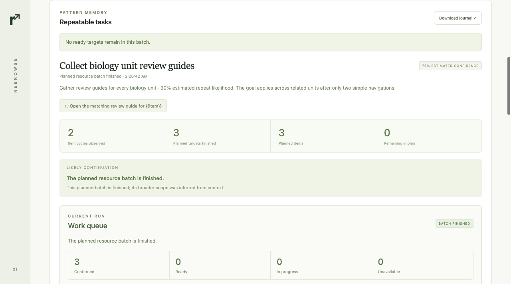

<p align="center">
  
</p>

<h1 align="center">Rebrowse</h1>

<p align="center">A Chrome workspace with live predictions, powered by Subquadratic.</p>

<p align="center">
  <a href="https://rebrowse-live.onrender.com/"><strong>Try the demo</strong></a> ·
  <a href="#documentation">Docs</a> ·
  <a href="#build-from-source">Build from source</a>
</p>

<p align="center">
  
</p>

Browse in a dedicated Chrome session. Rebrowse turns page activity into next-action predictions and can continue a repeatable task once it has enough evidence.

## What you get

- **Live predictions.** See likely next actions and the observations behind them.
- **Repeatable tasks.** Open related resources or continue a routine with a bounded workflow, a visible queue, and a stop control.
- **Record and replay.** Save a local browsing session and evaluate its checkpoints without running browser actions.

## Try it

Open the demo, click **Start browsing**, and enter a public website or search. The browser and dashboard run side by side with no installation or API key required. [Live demo](https://rebrowse-live.onrender.com/)

## Build from source

Install Node.js 22.18 or newer and Google Chrome.

```sh
git clone https://github.com/tofulot/Rebrowse.git
cd Rebrowse
npm ci
cp -n .env.example .env
npm start
```

To enable predictions, workflows, and live replay, add a `SUBQ_API_KEY` with Savant access to `.env` and restart. [SubQ authentication](https://docs.subq.ai/using-the-api/authentication/)

## Documentation

- [Local setup, recording, and privacy](docs/usage.md)
- [Self-hosting and Render deployments](docs/deployment.md)
- [Development, checks, and contributing](docs/development.md)

[Package metadata](package.json) declares ISC.
